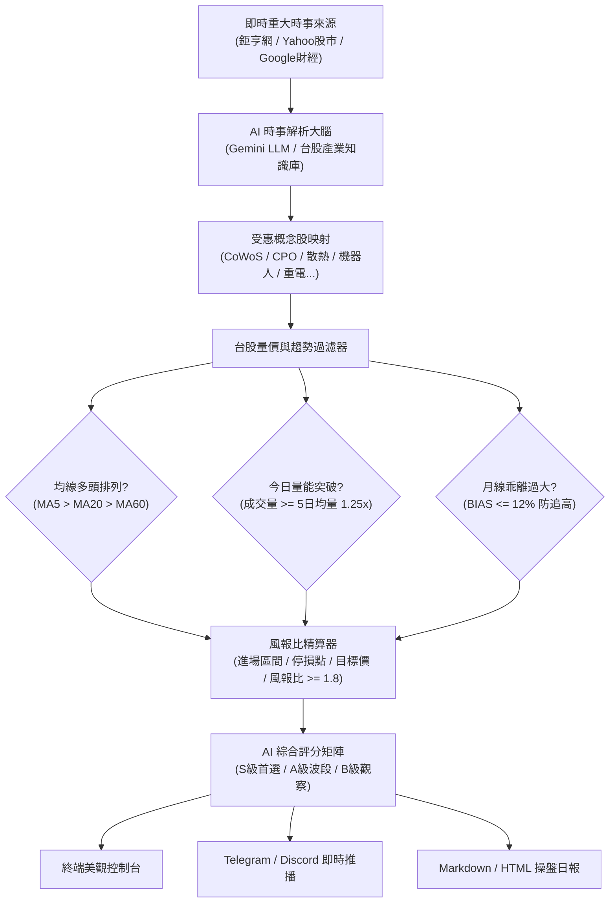

# 🚀 台股 AI 時事智能監控與精準選股系統 (TW Stock AI Sentinel)

> **專為台灣股市設計的「時事題材驅動 + 均線量價共振 + 嚴格風報比防守」AI 智能量化監控系統。**

---

## 💡 為什麼需要這套系統？（解決散戶最大痛點）

在台股市場中，一般投資人最常面臨的虧損陷阱是：
1. **看報紙買股票被當韭菜割**：常常看到頭條寫「某公司營收大好 / 獲利翻倍」，隔天開盤一買就跌，遇到主力「利多出盡倒貨」，套在山頂。
2. **看不懂新聞背後的真正受惠股**：例如新聞報導「輝達 GB200 算力飆升」，卻不知道台股中誰才是水冷板主要供應商（奇鋐、雙鴻）、誰才是 CoWoS 設備直接受惠者（弘塑、辛耘、萬潤）。
3. **沒有進出場交易計畫**：買進後不知道何時停損、何時停利，賺一點就跑、賠錢就凹單。

本系統透過 **「AI 產業知識鏈推理」+「量價多頭嚴格過濾」+「月線乖離率防追高」+「風報比精算」** 四道關卡，只有在「時事催化 + 量價爆量表態 + 均線多頭」同時成立時，才發出強烈推薦訊號！

---

## 🏗️ 系統四大核心架構



### 1. 時事新聞監控 (`news_fetcher.py`)
- 即時對接 **鉅亨網 (Anue Cnyes API)**、**Yahoo 奇摩股市 RSS**、**Google 財經**。
- 自動去重、提取標題與核心摘要，具備離線自動降級備援機制，保證離線/沙盒環境下亦可流暢回測與運作。

### 2. AI 語意推理與概念股知識庫 (`ai_analyzer.py` + `knowledge_graph.py`)
- 整合 **Google Gemini 大語言模型** 與 **內建台股產業知識庫（超過 30+ 核心題材、數百檔熱門個股）**。
- 精準分析：
  - **題材爆發力與催化強度**（0 ~ 100 分）
  - **直接受惠供應鏈個股代號**（如散熱雙雄、CPO矽光子、CoWoS設備、重電外銷、機器人視覺等）
  - **受惠邏輯與持續性**（短線題材 vs. 波段業績擴張）

### 3. 量價趨勢驗證與風控精算 (`tw_market_data.py` + `technical_filter.py`)
- **均線多頭護體**：排除空頭反彈或破線個股，只做站上 20MA 月線生命線的強勢股。
- **量能確認**：今日成交量必須高於 5 日均量（1.25 倍以上），確認有大戶主力資金進駐。
- **月線乖離率 (BIAS) 防追高**：若乖離率 > 12%，系統自動標記「⚠️ 過熱警戒 - 嚴禁追高，等待拉回支撐」。
- **自動產出操盤計畫**：試算建議買進區間、精確停損價（跌破月線或 -5%）、波段目標價，確保 **風報比至少 1:1.8 以上**。

### 4. 綜合推薦與即時推播 (`scanner.py` + `notifier.py`)
- 綜合分數：
  - **S 級【首選攻擊股】(>= 80分)**：時事、量能、均線三重共振，強烈推薦！
  - **A 級【波段潛力股】(70 ~ 79分)**：趨勢向上，具備波段潛力。
  - **B 級【觀察名單】(55 ~ 69分)**：題材具備，等待放量突破。
- 支援 **Telegram Bot**、**Discord Webhook** 自動發布卡片通知，並在 `reports/` 自動生成專業 Markdown 操盤日報。

---

## ⚡ 快速開始 (Quick Start)

### 1. 安裝相依套件

本系統使用標準 Python 套件：
```bash
pip install -r requirements.txt
```

### 2. 設定環境變數 (選填)

複製 `.env.example` 為 `.env`：
```bash
cp .env.example .env
```
- 若要啟用 **Google Gemini 深度語意分析**，請填入 `GEMINI_API_KEY`（至 [Google AI Studio](https://aistudio.google.com/) 免費申請）。*若未設定，系統自動使用內建高效台股 NLP 語意推理雙引擎，不影響任何功能！*
- 若要啟用 **Telegram / Discord 即時推播**，請填入相應之 Token 或 Webhook URL。

---

## 📱 啟動台股 AI 視覺化 APP (手機 / 電腦通用)

本系統已內建完整的 **Web App / PWA 視覺化戰情室**，無論在電腦螢幕或手機瀏覽器上，都能享受如同專業操盤 App 般的互動體驗！

### 方式一：一鍵雙擊啟動 (Windows 專用)
直接在資料夾中雙擊執行：
👉 **[`啟動台股AI_APP.bat`](file:///C:/Users/USER/.gemini/antigravity/scratch/tw-stock-ai-agent/啟動台股AI_APP.bat)**
系統會自動啟動後端並為您開啟預設瀏覽器！

### 方式二：指令啟動
```bash
cd C:\Users\USER\.gemini\antigravity\scratch\tw-stock-ai-agent
python app.py
```

- **電腦本機網址**：`http://localhost:8000`
- **手機連線網址**：輸入終端機顯示的區網 IP（例如 `http://192.168.1.xxx:8000`，手機與電腦連同一個 Wi-Fi 即可）。
- **📲 手機 App 化秘訣**：
  - **iPhone (iOS Safari)**：開啟網址後，點選下方「分享」按鈕 ➔ 選擇 **「加入主畫面」**。
  - **Android (Chrome)**：點選右上角選單 ➔ 選擇 **「安裝應用程式」** 或 **「加到主畫面」**。
  即可在手機桌面上像原生 App 一樣一鍵點開！

---

## 🖥️ 指令操作說明

進入專案目錄：
```bash
cd C:\Users\USER\.gemini\antigravity\scratch\tw-stock-ai-agent
```

### 模式 A：執行全市場時事與量價綜合掃描 (單次推薦)
```bash
python main.py --mode scan
```
輸出當前台股最值得買進的 Top 10 推薦個股排行榜、詳細分析與操盤計畫，並自動存檔操盤日報。

### 模式 B：盤中每分鐘即時監控循環 (1分鐘即時偵測時事與 Top 3 飆股)
```bash
python main.py --mode watch --interval 60 --notify
```
- **每 60 秒 (1分鐘)** 自動刷新偵測鉅亨網、Yahoo 股市與 Google 財經的最新報導與快訊。
- 本分鐘一有突發時事，立即觸發「🚨 突發快訊警示」，並由雙 AI 引擎重新精選 **Top 3 首選推薦**。
- 同時計算最新成功率（勝率）、買進區間、停損點，並自動發送 Telegram / Discord 即時卡片推播！

### 模式 C：單一個股即時健檢
針對您目前持有或想買的單一檔股票進行「時事熱度 + 技術量價」全方位診斷：
```bash
python main.py --stock 2330
python main.py --stock 3017
python main.py --stock 3450
```

---

## 📈 實戰操盤紀律心法（如何真正靠它賺錢）

1. **「只買 S 級與 A 級爆量股」**：
   - 看到 AI 推薦時，優先挑選訊號為 `🔥 爆量攻擊買點` 或 `📈 拉回月線支撐布局` 的個股。
2. **「嚴禁追高，認真看乖離率 (BIAS)」**：
   - 如果新聞很熱門，但該股乖離率已經超過 12%，絕對不要在盤中追高！將其放入觀察名單，等股價拉回回測 5MA 或月線量縮再進場。
3. **「進場前先看停損價」**：
   - 系統為每檔股票計算了精確的「防守停損價」（通常是關鍵均線下方 1.5%）。買進同時請在券商軟體預設好智慧停損單，跌破無條件離場，將最大虧損控制在 4%~5% 以內。
4. **「讓獲利奔跑」**：
   - 到達「第一目標價」時可先分批獲利了結 1/2，剩餘部位移動停損至進場成本價，以零風險博取「第二波段目標」的翻倍暴利。

---

## 📂 專案檔案結構

```
tw-stock-ai-agent/
│
├── config.py              # 系統整體配置 (API 金鑰、新聞設定、風控閥值)
├── knowledge_graph.py     # 台股 30+ 題材產業鏈與概念股知識圖譜庫
├── news_fetcher.py        # 時事新聞抓取模組 (鉅亨網 API, Yahoo股市, Google財經)
├── tw_market_data.py      # 台股行情資料庫與均線、量比、乖離指標計算
├── ai_analyzer.py         # AI 智能分析大腦 (Gemini LLM + 內建台股 NLP 推理雙引擎)
├── technical_filter.py    # 技術面多頭確認、防追高過濾與風報比試算器
├── scanner.py             # 核心選股掃描與綜合評分引擎
├── notifier.py            # 美觀終端看板、Telegram/Discord 推播與 Markdown 日報產生器
├── main.py                # 主程式入口 (支援 scan, watch, stock 診斷)
├── requirements.txt       # 相依套件清單
├── .env.example           # 環境變數設定範本
└── reports/               # 自動產出的 Markdown / HTML 操盤日報存檔資料夾
```

